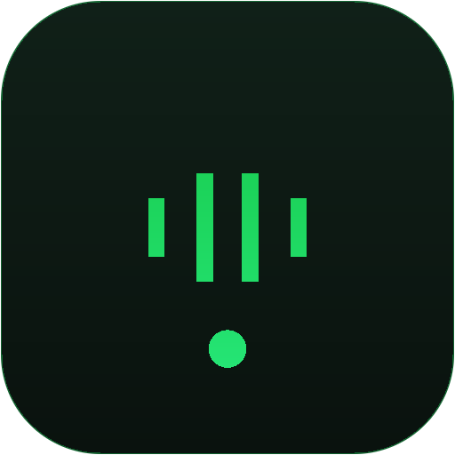

# 🎵 VYBE Music Player

<div align="center">



### High-Fidelity, Offline-First Music Player with Ambient Glassmorphism
*A studio-grade desktop and mobile audio experience designed for true audiophiles.*

[](https://github.com/DaivikOPX/VYBE-Music-Player/releases)
[](https://github.com/DaivikOPX/VYBE-Music-Player)
[](LICENSE)
[](https://react.dev)
[](https://www.typescriptlang.org/)
[](https://www.electronjs.org/)

[Features](#-key-features) • [Screenshots](#-preview--aesthetic) • [Architecture](#-architecture) • [Getting Started](#-getting-started) • [Audio Engine](#-audio-engine-specifications) • [Keyboard Shortcuts](#-keyboard-shortcuts) • [Contributing](#-contributing)

</div>

---

## 🌟 Overview

**VYBE** is an offline-first music player that bridges the gap between the familiar Spotify desktop UI and high-fidelity local audio processing. Engineered with zero external telemetry, cloud lock-in, or track throttling, VYBE provides a zero-latency audio engine with studio mastering controls directly over your local music library.

Whether you are listening to lossless FLACs, mastering with our 6-band biquad parametric equalizer, creating nested playlist folders, or relaxing under the frosted acrylic glass backdrop, VYBE is tuned for absolute performance.

---

## ✨ Key Features

### 🎧 Studio Audio Engine
* **Lossless Audio Decode**: Native, Bit-perfect playback for **FLAC, MP3, WAV, AAC, M4A, OGG, OPUS, and AIFF**.
* **Real-Time 6-Band Parametric Equalizer**: Web Audio API Biquad filter processing at `60Hz`, `150Hz`, `400Hz`, `1kHz`, `2.4kHz`, and `15kHz` with gain ranging from `-12dB` to `+12dB`.
* **Zero-Latency Crossfade**: Linear/equal-power dual-gain crossfading from `0s` up to `12s`.
* **A–B Looper**: Instant boundary looping (`[A]`, `[B]`, `Clear`) for musicians, transcribers, and beat analysis.
* **Pitch-Preserving Variable Speed**: Smooth playback rate adjustment from `0.5x` to `2.0x` without vocal pitch distortion.
* **Volume Normalization & Limiter**: Dynamic RMS peak leveling (`Quiet`, `Normal`, `Loud`) with zero clipping.
* **Mono Audio & Stereo Balance**: Left/right channel balance adjustment and one-click channel summing.

### 🎨 Visuals & Theming
* **Transparent Theme (Frosted Acrylic)**: Dynamic Gaussian-blurred album art backdrop with adjustable blur radius and panel translucency.
* **AMOLED Pure Black**: 100% true-black surfaces optimized for OLED displays and battery efficiency.
* **Spotify-Identical Density Zoom**: Native UI scaling from **70% to 130%** with `Dense`, `Default`, and `Spacious` modes and discrete 7-step keyboard shortcuts (`Ctrl +` / `Ctrl -`).
* **Real-Time Visualizers**: Dynamic audio frequency bar visualizers and circular wave animations.

### 📚 Library & Workflow Mastery
* **Local File & Folder Import**: Automatic recursion through nested folders with instantaneous multi-thread ID3 metadata parsing (`music-metadata` + `node-id3`).
* **Synced LRC Lyrics**: Real-time karaoke-style synchronous lyrics display with auto-scroll and manual time-offset fine-tuning (`±0.5s`).
* **Playlist Folders & Organization**: Create nested folder hierarchies to keep hundreds of playlists structured.
* **ID3 Tag Editor**: Edit Title, Artist, Album, Year, Genre, Track Number, and toggle Spotify-styled `[E]` (Explicit) badges on local tracks.
* **M3U / M3U8 Playlist Export & Import**: Import and export your playlists with one click for interoperability with other players.
* **Listening Analytics**: Comprehensive offline local stats tracking your most played artists, albums, top tracks, and total listening hours.

---

## 📸 Preview & Aesthetic

| Main Viewport & Library | Transparent Theme & Equalizer |
|:---:|:---:|
| Sleek Spotify desktop styling with quick access shelves and local folder management | Real-time audio DSP, Biquad EQ, dynamic album backdrop, and synced lyrics |

---

## 🏗️ Architecture

VYBE is built as a unified cross-platform codebase sharing a single React 19 + TypeScript core:

```
spotify-clone/
├── src/
│   ├── components/       # Pixel-accurate UI components
│   │   ├── AudioToolsPopover.tsx # Speed, A-B loop, Sleep Timer, EQ
│   │   ├── MainViewport.tsx      # Home shelves, quick grid, playlists
│   │   ├── SettingsView.tsx      # Zoom slider, audio DSP settings
│   │   ├── Sidebar.tsx           # Library navigation, playlist folders
│   │   ├── TrackRow.tsx          # Virtualized track list with [E] badge
│   │   └── reactbits/            # GPU-accelerated motion & spotlight cards
│   ├── context/
│   │   └── PlayerContext.tsx     # Centralized audio engine, Web Audio API graph
│   ├── types.ts                  # Strictly typed interfaces & models
│   └── utils/
│       ├── lrcParser.ts          # Synchronized LRC parser
│       └── searchUtils.ts        # Fast fuzzy indexing for local library
├── electron/
│   ├── main.cjs                  # Electron main process & native dialogs
│   └── preload.cjs               # Secure IPC bridge
├── android/                      # Native Android project (Capacitor)
└── public/                       # Static brand assets & default covers
```

---

## 🚀 Getting Started

### Prerequisites
* [Node.js](https://nodejs.org/) (v18.0.0 or higher recommended)
* `npm` or `pnpm`

### Installation

```bash
# Clone the repository
git clone https://github.com/DaivikOPX/VYBE-Music-Player.git

# Navigate into project directory
cd VYBE-Music-Player

# Install dependencies
npm install
```

### Running Locally

```bash
# Launch Vite Web Dev Server
npm run dev

# Launch Desktop App (Electron)
npm run desktop
```

### Building for Production

```bash
# Production Web Build
npm run build

# Standalone Windows Executable / Portable (.exe)
npm run desktop:portable

# Packaged Windows Directory
npm run desktop:build

# Sync to Android (Capacitor)
npm run android:sync
```

---

## 🎹 Keyboard Shortcuts

VYBE features comprehensive global and focused keyboard shortcuts:

| Shortcut | Action |
| :--- | :--- |
| <kbd>Space</kbd> | Play / Pause |
| <kbd>Ctrl</kbd> + <kbd>→</kbd> | Next Track |
| <kbd>Ctrl</kbd> + <kbd>←</kbd> | Previous Track |
| <kbd>Ctrl</kbd> + <kbd>↑</kbd> | Increase Volume |
| <kbd>Ctrl</kbd> + <kbd>↓</kbd> | Decrease Volume |
| <kbd>Ctrl</kbd> + <kbd>+</kbd> / <kbd>=</kbd> | Zoom In (Step discrete density) |
| <kbd>Ctrl</kbd> + <kbd>-</kbd> | Zoom Out (Step discrete density) |
| <kbd>Ctrl</kbd> + <kbd>0</kbd> | Reset Zoom to 100% |
| <kbd>Ctrl</kbd> + <kbd>,</kbd> | Open Settings |
| <kbd>L</kbd> | Open Lyrics View |
| <kbd>[</kbd> | Set A-B Loop Point A |
| <kbd>]</kbd> | Set A-B Loop Point B |
| <kbd>C</kbd> | Clear A-B Loop |
| <kbd>?</kbd> or <kbd>Ctrl</kbd> + <kbd>/</kbd> | Show Keyboard Shortcuts Modal |

---

## 🛡️ Privacy & Offline Guarantee

* **100% Offline**: Your music, metadata, listening analytics, and playlists never leave your machine.
* **No Telemetry**: Zero tracking scripts, analytics beacons, or third-party SDKs.
* **Local Storage First**: Metadata caches and audio settings are safely persisted in standard browser `localStorage` and native app storage.

---

## 🤝 Contributing

Contributions are what make the open source community such an amazing place to learn, inspire, and create. Any contributions you make are **greatly appreciated**!

1. Fork the Project
2. Create your Feature Branch (`git checkout -b feature/AmazingFeature`)
3. Commit your Changes (`git commit -m 'Add some AmazingFeature'`)
4. Push to the Branch (`git push origin feature/AmazingFeature`)
5. Open a Pull Request

---

## 📜 License

Distributed under the **MIT License**. See `LICENSE` for more information.

---

<div align="center">

Crafted with 💚 for music lovers everywhere. Built by [Daivik Dudeja](https://github.com/DaivikOPX).

</div>
